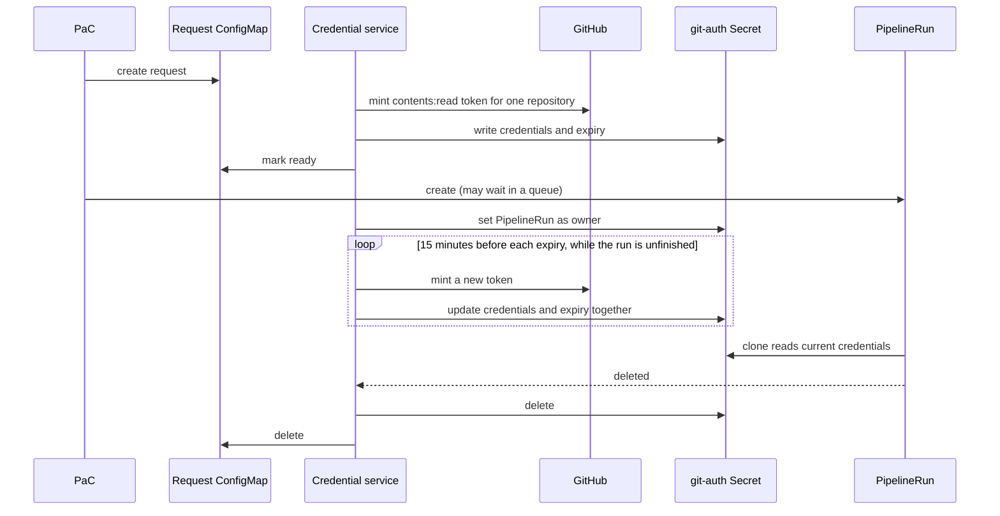

# 0003. GitHub Credential Service Alongside Pipelines-as-Code

Date: 2026-10-28

## Status

Proposed

<!-- Status lifecycle:
- Proposed: Under discussion, not yet accepted
- Accepted: Approved, ready for implementation
- Implemented: Done and reflected in the product
- Superseded: Replaced by a newer ADR (link to it)
- Rejected: Not accepted (stays in repo for reference)
-->

## Context

Pipelines-as-Code (PaC) starts Tekton PipelineRuns when something happens on a Git repository, such as a pull request. A PipelineRun is one execution of a pipeline. For a private GitHub repository, the first thing the PipelineRun does is clone the code, and for that it needs a credential.

Today PaC gets that credential from its GitHub App. A GitHub App is an identity installed on an organization or repository. It holds a private key, and with that key it can ask GitHub for an installation token: a password-like string scoped to some repositories and permissions. PaC requests one when it creates the PipelineRun and writes it into a Kubernetes Secret (a small object that stores sensitive values) named after the run. The clone task reads that Secret through three fields: `.gitconfig`, `.git-credentials` and `git-provider-token`.

Installation tokens expire after one hour, and GitHub does not let anyone extend or refresh them. A PipelineRun can wait longer than that before it starts: behind PaC's own concurrency limit, or in a cluster scheduler that holds runs until there is capacity. When it finally runs, the token is dead and the clone fails. Small worker pools and busy repositories hit this most.

Affected: PipelineRuns on private GitHub repositories that use PaC's GitHub App credentials. Other Git providers, user-managed Secrets, PaC's own GitHub API calls and where the App private key is stored are out of scope here.

## Decision

We will ship a separate credential service next to PaC in OpenShift Pipelines. It owns the PipelineRun's git-auth Secret: it creates it, renews the token in it while the run is unfinished, and lets it be deleted with the run. PaC keeps everything else, including events, repository authorization, creating and queuing PipelineRuns, reporting status to GitHub, and its own GitHub API authentication. The service never creates or schedules a PipelineRun.

We prefer a new service over adding renewal to PaC because it keeps security concerns apart. The code that mints tokens and writes them into tenant namespaces runs under its own service account with its own narrow permissions, away from PaC's internet-facing webhook handling, and it can be reviewed, audited and restricted on its own.

The service is easy to turn off. The OpenShift Pipelines operator will most likely ship it disabled by default, because only large installations, where PipelineRuns routinely queue for more than an hour, need it. Disabling it brings back today's behavior: PaC writes the token into the Secret itself.

The Secret keeps the same name and fields, so pipelines and clone tasks do not change.

PaC needs a small, opt-in hook to hand the Secret over to the service. That hook belongs upstream in tektoncd/pipelines-as-code; the service itself is the downstream part this ADR covers.

The service does two separate jobs: it gets a token from somewhere, and it keeps the Secret in each namespace fresh. We want the second job to be the core of the service and the first to be pluggable, so that an installation that already has a way to mint GitHub tokens can plug it in and let the service only push renewals. The [token sources](#token-sources) section lists the integrations we have in mind.

### How it works

PaC asks for credentials by creating a request: an immutable ConfigMap in a namespace that only PaC and the cluster administrator can write to. The request names the repository, the target namespace and Secret name, and the PipelineRun. The service checks it against its own configuration, mints a token, writes the Secret and reports progress as annotations on the request. The token only ever lives in the Secret. Requests and Secrets are the whole state, so there is no database and no token endpoint, and a restarted service picks up where it left off.

For one PipelineRun:

1. PaC picks the PipelineRun name and Secret name and creates the request. A retry reuses the same names.
2. The service mints a token limited to `contents: read` on that one repository, writes the Secret and marks the request ready. PaC waits up to 30 seconds for this.
3. PaC creates the PipelineRun through its normal path, including its concurrency queue.
4. The service sees the run, records its UID and sets the run as the Secret's owner. Kubernetes deletes owned objects when the owner goes away, and a later run reusing the same name never inherits the request.
5. While the run waits or runs, the service replaces the token before it expires, in the same Secret.
6. The clone step reads whatever is in the Secret when its pod starts.
7. When the run, its `finally` tasks and its pods are done, renewal stops. Deleting the run deletes the Secret and the request.



GitHub returns the real expiry with each token. The service stores it in the Secret and renews 15 minutes before it, so a token minted at 10:00 is replaced at 10:45, that one at 11:30, and so on. Credential fields and expiry change in one update. If a write fails, the old expiry stays and the service retries with backoff. It never revokes the old token, because a running task may still use it. After a restart, it rebuilds the schedule from the requests and Secrets and renews anything overdue at once.

### Changes in PaC

The hook is off by default and only applies to GitHub App events for the configured repositories. When it is on, PaC creates the request and waits for it, and skips its own Secret creation, ownership and cleanup for those runs. Those runs carry the label `git-auth-secret-owner: credentials-service`, so a later configuration change cannot confuse which runs the service owns. If credentials are not ready within 30 seconds, PaC reports a failure and does not create the run. A run that asks for extra repositories in its token is refused instead of getting a narrower token than it expects. Other providers and existing runs behave as before.

The proposed settings are controller environment variables:

```yaml
env:
  - name: PAC_GITHUB_CREDENTIALS_SERVICE
    value: "true"
  - name: PAC_GITHUB_CREDENTIALS_SERVICE_REPOSITORIES
    value: "https://github.com/org/app,https://github.com/org/lib"  # or "*"
  - name: PAC_GITHUB_CREDENTIALS_SERVICE_NAMESPACE
    value: pipelines-credentials
  - name: PAC_GITHUB_CREDENTIALS_SERVICE_WAIT
    value: 30s
```

A supported version should move these into the `pipelines-as-code` ConfigMap or the Repository custom resource.

To see what the service is doing for a run, look at the request and the Secret:

```sh
# requests and their state annotations
kubectl get configmaps -n pipelines-credentials -o yaml

# owner and annotations of the run's Secret (never print its data)
kubectl get secret <secret-name> -n <namespace> \
  -o jsonpath='{.metadata.ownerReferences}{"\n"}{.metadata.annotations}{"\n"}'
```

### Token sources

A token source is an adapter that hands the service a fresh installation token for a given repository. The rest of the service (requests, Secrets, renewal schedule, cleanup) does not care where the token came from. The first phase ships one adapter, which reads the GitHub App private key and asks GitHub directly, as described above. How adapters are configured and what exactly they must return will be designed in a later phase.

Integrations we expect to need:

- A central token-minting service. Konflux is building one so that its controllers stop sharing the GitHub App private key. With an adapter for it, the credential service would never see the key; it would ask that service for tokens and only take care of pushing renewals into each namespace.
- A security token service (STS) using OIDC federation, such as Octo STS. The credential service proves its own identity with a Kubernetes service account token, and the STS returns a GitHub token allowed by a trust policy kept in the repository.
- Vault or OpenBao with a GitHub secrets engine plugin, for installations that already keep their credentials there.
- An App private key held in a cloud KMS or HSM. GitHub suggests keeping the key in a key vault that can sign but never export it; the adapter would only ask the vault to sign the short JWT that GitHub exchanges for a token.
- The External Secrets Operator `GithubAccessToken` generator, for installations that already run ESO and have the App key in an ESO store.

The renewal side is also useful beyond PaC. Konflux's MintMaker dependency-update pipelines and agent workloads running as PipelineRuns, such as fullsend, need the same short-lived, per-repository tokens in their namespaces. Keeping the request format small and independent of PaC would let them reuse the service.

### Security

Only PaC and the administrator can create requests. PipelineRun service accounts cannot read the request namespace or any token source credentials, and the App private key never reaches a PipelineRun pod. The service accepts only its configured installation, repositories and output namespaces, and only mints `contents: read`. With the default adapter it reads the App key, so a compromised service could mint tokens for anything the App can reach, and PaC keeps the key for its own API calls, which makes two components holding it. With an external token source the service holds no key at all, and the key stays in one central place.

## Considered Options

| Option | Good | Bad |
| --- | --- | --- |
| Do nothing; use a long-lived personal token or SSH key, add capacity, retrigger failed runs | No engineering work | Long-lived secrets to store and rotate; the next long wait fails again |
| Ask GitHub for a longer token | Would keep today's design | GitHub offers no such setting |
| Renew the Secret inside PaC | No new component; same renewal logic | Grows PaC's controller; mixes token minting into the internet-facing component; PaC must be up for renewals |
| Refresh just before PaC releases the run from its queue | Fewer token requests; can hold the run until refresh succeeds | Needs tight queue coordination; a long wait for a node after release can still expire the token; does nothing for external schedulers |
| Request ConfigMaps and a separate service (chosen) | No new CRD; no task changes; works with any queue; token source can be swapped | Another service; second App key holder with the default adapter; runs depend on it to launch |
| Empty annotated Secret that the service fills | One object, no extra namespace | Tenants can create Secrets, so any tenant could ask for any repository the App reaches |
| Annotations on the PipelineRun | Direct link to the run | Anyone who creates PipelineRuns can set them; the run references a Secret that does not exist yet |
| External Secrets Operator `GithubAccessToken` generator on its own | Almost no code to write | Requires ESO and its CRDs; refreshes on a timer, keeps minting after the run ends until the `ExternalSecret` is deleted; App key placement needs care. Still usable as a token source |
| Mint the token at clone time | Nothing stored, renewed or cleaned up; waits stop mattering | Every clone task needs a credential helper; a token endpoint becomes a hard dependency |

Minting at clone time is the better long-term answer. Kubernetes gives every pod a signed service account token that proves which pod it is. Git can call a credential helper, a small program it asks for a password. The clone step's helper would send the pod's token to a token service, which checks it with the Kubernetes TokenReview API, works out which PipelineRun the pod belongs to and which repository that run came from, and returns a fresh one-hour installation token for that repository only. The service must look at the PipelineRun and not only the service account, because many runs in a namespace share one service account. This pattern is a security token service (STS); Octo STS from Chainguard is a public example for GitHub, where a YAML trust policy in the repository says which identities may get which permissions.

That token service could live inside PaC, which already has the App key and knows each run's repository, or in a separate component if other tools need tokens or the key should leave the internet-facing controller. In both cases the token endpoint must not share PaC's public webhook entrance. We defer this option because it changes every clone task, including tasks PaC does not maintain. The token sources above keep the door open: a token service built for clone-time minting can also feed the credential service in the meantime.

## Consequences

### Benefits

- PipelineRuns on private GitHub repositories survive queue waits longer than an hour, whatever holds them back.
- Pipelines, tasks and the Secret format stay the same.
- Token minting and Secret writing sit in their own component with their own permissions, separate from PaC's webhook handling.
- PaC's controller does not grow a renewal loop, and the service can be released and scaled on its own.
- Installations that do not need it keep today's behavior and run nothing extra.
- Pluggable token sources let installations that already mint GitHub tokens centrally (Konflux, an STS, Vault, a KMS) reuse that and keep the App key in one place, and let other workloads such as MintMaker reuse the renewal side.

### Drawbacks

- One more service to deploy, monitor and upgrade where it is enabled.
- More GitHub token requests: one every 45 minutes per waiting run.
- No credentials, no PipelineRun. If the service is down, PaC fails new runs after 30 seconds.
- With the default adapter, a second component holds the GitHub App private key.
- Each token source is another integration to test and support, and the adapter boundary has to be designed carefully so it does not widen what a token can do.

### Limitations and common problems

If GitHub or the service is unavailable longer than the remaining token lifetime, the clone still fails. Nothing pauses the queue during an outage.

Updating a Secret cannot reach credentials a container already copied. Kubernetes does not update environment variables or `subPath` mounts from a changed Secret. This design works because the clone step reads the Secret when its pod starts; a task that copies credentials early, or a later Git operation more than an hour after the clone, can still fail.

If PaC creates a request and then crashes before creating the run, the service never sees an owner. It keeps renewing and logs the request as unbound instead of deleting it on a timeout, because the run might still arrive. Someone has to delete unbound requests by hand, and each one costs GitHub API calls until then.

### Follow-up actions

- Add an operator setting that deploys the service and turns on the PaC hook together, off by default.
- Propose the PaC hook upstream in tektoncd/pipelines-as-code, with settings in the `pipelines-as-code` ConfigMap or Repository CR.
- Design the token source adapter interface, then add adapters for the Konflux token service and an STS first, followed by Vault/OpenBao, KMS signing and ESO as needed.
- Agree with Konflux on a request format that MintMaker and other non-PaC workloads can use.
- Add metrics and alerts for renewal failures and unbound requests.
- Test with a simulated clock: waits over one hour, GitHub and Secret-update failures, service restart, cancelled and deleted runs, unchanged scope after renewal, user-managed Secrets left alone. Then run a private-repository PipelineRun through a real queue wait over one hour.
- Check how the shipped git-clone task reads the Secret.
- Revisit clone-time minting if changing clone tasks becomes acceptable.

## References

- [Generating an installation access token for a GitHub App](https://docs.github.com/en/apps/creating-github-apps/authenticating-with-a-github-app/generating-an-installation-access-token-for-a-github-app)
- [Kubernetes Secrets](https://kubernetes.io/docs/concepts/configuration/secret/) and [owners and dependents](https://kubernetes.io/docs/concepts/overview/working-with-objects/owners-dependents/)
- [Kubernetes TokenReview API](https://kubernetes.io/docs/reference/kubernetes-api/authentication-resources/token-review-v1/) and [service account issuer discovery](https://kubernetes.io/docs/tasks/configure-pod-container/configure-service-account/#service-account-issuer-discovery)
- [Git credential helpers](https://git-scm.com/docs/gitcredentials)
- [External Secrets Operator GitHub generator](https://external-secrets.io/latest/api/generator/github/)
- [Octo STS](https://github.com/octo-sts/app)
- [Managing private keys for GitHub Apps](https://docs.github.com/en/apps/creating-github-apps/authenticating-with-a-github-app/managing-private-keys-for-github-apps) (key vault storage) and [generating a JWT for a GitHub App](https://docs.github.com/en/apps/creating-github-apps/authenticating-with-a-github-app/generating-a-json-web-token-jwt-for-a-github-app)
- [Vault GitHub secrets engine plugin](https://github.com/martinbaillie/vault-plugin-secrets-github) and [OpenBao](https://openbao.org)
- [Pipelines-as-Code](https://github.com/tektoncd/pipelines-as-code), [Konflux](https://github.com/konflux-ci), [MintMaker](https://github.com/konflux-ci/mintmaker) and [fullsend](https://github.com/fullsend-ai/fullsend)
