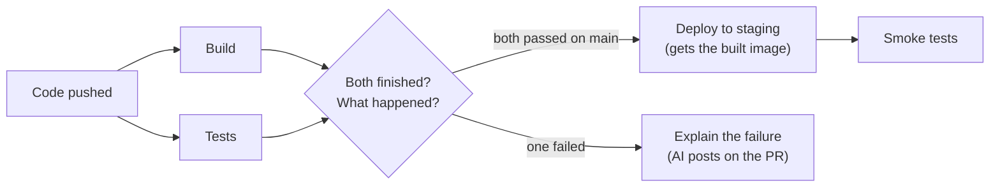

<!-- Status lifecycle:
- Proposed: Under discussion, not yet accepted
- Accepted: Approved, ready for implementation
- Implemented: Done and reflected in the product
- Deprecated: Not required anymore
- Superseded: Replaced by a newer ADR (link to it)
- Rejected: Not accepted (stays in repo for reference)
-->
---

# ADR-0003: PAC: Trigger PipelineRuns after other PipelineRuns

TL;DR: today every pipeline in a repository starts on its own when code
is pushed. This ADR lets a pipeline wait for others and start only when
they are done, for example "deploy once build and tests have both
passed" or "explain what went wrong if either failed". The rule lives in
the pipeline's YAML, and the waiting pipeline can receive values from
the earlier ones, such as the digest of the image that was just built.



## Context

`Required`

Pipelines-as-Code (PAC) starts PipelineRuns from Git events. Each
definition in `.tekton/` matches the event on its own, and PAC cannot
start one PipelineRun because another one finished.

Teams ask for that ordering: deploy to staging after build and tests
pass, notify someone when a build succeeds, or run an AI tool such as
paco to explain a failure. Today they put everything in one large
Pipeline or build the ordering outside PAC.

Whether such work should start depends on the results of earlier runs
and on the event, branch and changed files. PAC already evaluates the
event, branch and files in `pipelinesascode.tekton.dev/on-cel-expression`,
so the results of earlier runs can go into the same expression.

## Decision

`Required`

- Chosen option: dependencies and CEL conditions in PAC, over building
  the feature into Tekton Pipelines, a completion watcher outside PAC,
  or one combined Pipeline.

A definition lists the definitions it waits for in a new
`pipelinesascode.tekton.dev/on-pipelinerun` annotation. This document
calls it a follow-up. Once they have all finished, PAC evaluates the
follow-up's `on-cel-expression`, which can now read their results, and
starts it as an ordinary PipelineRun if the expression is true.

The feature belongs in upstream PAC and needs an upstream design. This
ADR records the direction OpenShift Pipelines needs; names and fields
below are proposals.

### Architectural Overview

`Required`

1. A Git event starts a group. PAC reads the definitions, works out
   which wait on which, and rejects missing names and loops.
2. PAC starts the definitions without dependencies, as today, and
   records the follow-ups as waiting.
3. When all dependencies of a follow-up have finished, PAC evaluates its
   expression. If true, PAC starts it; if false, PAC marks it skipped.
   A follow-up can be a dependency of another one, so chains work.
4. Follow-ups report through PAC's usual checks and comments, and never
   change the result of the runs they waited for.

### Implementation Details

`Required`

The example below assumes the repository has `build` and `tests`
definitions, and that `build` declares an `image-digest` result.

```yaml
apiVersion: tekton.dev/v1
kind: PipelineRun
metadata:
  name: deploy-staging
  annotations:
    pipelinesascode.tekton.dev/on-pipelinerun: '["build", "tests"]'
    pipelinesascode.tekton.dev/on-cel-expression: >-
      event == "push" && target_branch == "main" &&
      runs.all(name, runs[name].status == "Succeeded")
spec:
  pipelineRef:
    name: deploy
  params:
    - name: image
      value: "{{ runs.build.results.image-digest }}"
---
apiVersion: tekton.dev/v1
kind: PipelineRun
metadata:
  name: explain-failure
  annotations:
    pipelinesascode.tekton.dev/on-pipelinerun: '["build", "tests"]'
    pipelinesascode.tekton.dev/on-cel-expression: >-
      event == "pull_request" &&
      runs.exists(name, runs[name].status == "Failed")
spec:
  pipelineRef:
    name: paco-investigate
  params:
    - name: build-run
      value: "{{ runs.build.name }}"
    - name: tests-run
      value: "{{ runs.tests.name }}"
```

A `smoke-tests` follow-up waiting on `deploy-staging` would form a
three-stage chain.

The main rules:

- A follow-up must have an `on-cel-expression`. It keeps today's
  variables (`event`, `target_branch`, `files` and so on) and gains a
  read-only `runs` map with each dependency's status, Tekton reason,
  attempt and Pipeline results. CEL cannot read other cluster resources
  or add dependencies.
- `status` is one of `Succeeded`, `Failed`, `Cancelled`, `Skipped` or
  `Error`. A timeout counts as `Failed`; `reason` keeps Tekton's detail.
- PAC templating gains `{{ runs.<name>.<field> }}` with the run name,
  status and results. Follow-ups also get the standard variables such
  as `{{ revision }}`, `{{ target_branch }}` and `{{ pull_request_number }}`,
  which PAC can rebuild from the dependency's annotations. They do not
  get `{{ body }}` or `{{ headers }}` in the first version, because PAC
  does not keep the webhook payload after creating the first runs.
  PAC passes no logs; a follow-up that needs them fetches them with its
  own service account.
- Results can come from a pull request author's code. PAC must insert
  them as parameter values after parsing the YAML, not by text
  substitution as templating does today.
- A group is one Git event on one commit. A rerun of a dependency reuses
  the latest results of the others, so a passing rerun of `tests` can
  unlock `deploy-staging`. PAC never starts a follow-up twice on its
  own; a user has to ask with `/test <name>`.
- PAC reads follow-ups from the same revision as the rest of the group,
  with its existing trust rules. Waiting follow-ups show as pending
  checks, so required checks cannot pass early.
- PAC stores group state in the cluster, so simultaneous completions or
  a controller restart cannot start a follow-up twice.

Open questions for the upstream design:

- The full mapping of Tekton reasons to statuses.
- Size limits and JSON encoding for array and object results.
- Which run of each dependency a stage uses after reruns in the middle
  of a chain, and how skips propagate.
- `/retest`, `/ok-to-test` and `/cancel` on groups, and how providers
  without a neutral check state show a skipped follow-up.
- Whether some follow-ups must come from the default branch.
- Whether to keep the parts of the webhook payload that follow-ups
  reference, so they can use `{{ body }}` and `{{ headers }}` later.

`explain-failure` shows the AI use case: PAC treats it like any other
follow-up. Its own concerns, such as data access, secret redaction,
prompt injection and the model service, need a separate ADR.

Affected components: PAC matcher, controller and watcher, stored group
state, CEL, templating, and documentation.

## Security & Compliance

`Optional`

Follow-ups come from trusted definitions, and trust covers the
Pipelines, tasks and images they reference. A successful build does not
authorize a deployment; a deploying follow-up needs the usual
credentials and approvals.

PAC gives follow-ups run identifiers and Pipeline results, never logs or
credentials. Results are untrusted and inserted only after parsing. A
follow-up that sends data out of the cluster, for example to a model
service, is responsible for redaction and data handling.

## Compatibility & Migration

`Optional`

Repositories without `on-pipelinerun` keep their current behavior, and
existing expressions keep their meaning. A missing dependency is a
configuration error, not a reason to run. Rolling back means removing
the annotations; there is no data to migrate.

## Testability

`Required`

Unit and integration tests cover conditions over several runs, chains,
status mapping, results passing (including a result that tries to inject
YAML), reruns, and duplicate prevention under simultaneous completions
and restarts. End-to-end tests cover checks and comment commands on a
real provider.

## Operational Readiness

`Optional`

Users need to see each group's members and why a follow-up is waiting,
skipped or rejected. Follow-ups are ordinary PipelineRuns in the console
and `tkn`. PAC caps how many follow-ups run at once, emits events for
configuration errors and skipped follow-ups, and keeps a dependency's
PipelineRun from being pruned until its follow-ups have started.

## Scope

`Required`

- **In-Scope:**
  - The `on-pipelinerun` annotation, the `runs` CEL variable and
    template variables, including Pipeline results.
  - Groups, chains without loops, reruns, checks and comment commands.
- **Out-of-Scope:**
  - Dependencies across repositories or across events.
  - Starting a follow-up again automatically after it has run.
  - Requirements of individual follow-ups such as AI failure
    investigation, which need their own ADR.

## Acceptance Criteria

`Required`

The decision is considered accepted when:

- [ ] Tekton Pipelines maintainers have said whether they want a native feature PAC can build on
- [ ] Upstream PAC agrees on the annotation, CEL and template contract
- [ ] The open questions above are answered in the upstream design
- [ ] Trust, authorization and RBAC are reviewed
- [ ] Test and operational requirements are covered
- [ ] Required reviewers approve

## Considered Options

`Required`

| Option | Pros | Cons |
| ------ | ---- | ---- |
| Dependencies and CEL in PAC (chosen) | Uses `.tekton/` definitions; one expression covers results, event and branch; checks and comment commands work | PAC has to store group state and define rerun rules |
| Build it into Tekton Pipelines | One implementation for every Tekton user | Needs a TEP and takes longer; PAC still owns everything tied to Git |
| A watcher outside PAC (Tekton CloudEvents and Triggers) | Exists today | Cannot wait for two runs or avoid duplicates; no checks or `/retest`; needs its own Git token |
| One combined Tekton Pipeline | Tekton already orders tasks | Ties together work teams manage separately |
| Do nothing | No new code | Teams keep building the ordering themselves |

Tekton does not know which runs came from the same push, whether the
author is trusted, or what `/retest` means, so PAC keeps that part
whatever starts the PipelineRun. If Tekton maintainers want a native
feature for waiting and starting, PAC should build on it.

A watcher would be enough for AI failure investigation alone. Delivery
chains need PAC: waiting for both build and tests on `main`, passing
the image digest along, and holding required checks. Failure
investigation then reuses the same mechanism.

## Decision Drivers

`Required`

- Conditions over several runs, with every dependency visible in YAML.
- Follow-ups that are predictable and safe to rerun.
- Reuse of CEL, templating and ordinary PipelineRuns.

## Consequences

`Required`

- Positive outcomes:
  - Deployment chains, notifications and failure investigation live in
    `.tekton/` without extra services.
  - Runs can hand values such as image digests to the next stage.
- Risks:
  - PAC has to keep group state, including skipped follow-ups.
  - Reruns in the middle of a chain are hard to get right.
  - A follow-up waits for all its dependencies, so it starts late when
    one is slow.
- Follow-up ADRs:
  - AI failure investigation with paco.
  - Optional use of Tekton Results, which OpenShift Pipelines ships, to
    keep each group's runs, logs and webhook payload after pruning. PAC
    would map a group to a Result with the `results.tekton.dev/result`
    annotation. The state that prevents duplicate starts stays in PAC.

## Dependencies

`Required`

- Upstream PAC design and implementation.
- A position from Tekton Pipelines maintainers on a native feature.
- Provider support for pending and skipped checks.

## References

`Required`

- [Pipelines-as-Code](https://github.com/tektoncd/pipelines-as-code)
- [Tekton PipelineRun reasons](https://github.com/tektoncd/pipeline/blob/main/pkg/apis/pipeline/v1/pipelinerun_types.go)
- [Tekton Pipelines events](https://tekton.dev/docs/pipelines/events/)
- [Tekton Results watcher](https://github.com/tektoncd/results/blob/main/docs/watcher/README.md)
- [Common Expression Language](https://cel.dev/)
- [paco-cli](https://github.com/pipelines-as-code/paco-cli)

## Change Log

`Required`

| Date | Author | Change Summary |
| ---------- | -------- | ------------------- |
| 2026-10-13 | @chmouel | Proposed triggering PipelineRuns after other PipelineRuns |
